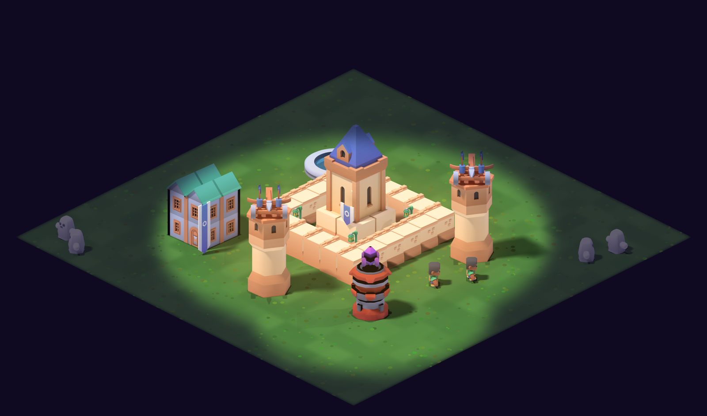

# Lanternfall — Хранители Мглы

Мобильная 2D-стратегия о свете и Мгле для iOS на **собственном движке** (C++17 + sokol). Диздок: [`docs/GDD.md`](docs/GDD.md).



## Структура

| Папка | Что внутри |
|---|---|
| `engine/src/game` | Игровое ядро без зависимостей от движка: деревня, детерминированный бой, генерация баз, кампания |
| `engine/src/engine` | Движок: пакетный 2D-рендер (Metal / OpenGL), атласы, шрифт с кириллицей, UI, ввод |
| `engine/src/client` | Игра: изометрическая камера, деревня, бой, окна, сюжетные диалоги |
| `engine/src/platform` | Платформенный слой (iOS / Linux), реализации sokol и stb |
| `engine/tests` | Тесты ядра (`lf_tests`) |
| `engine/ios` | Сборка `.ipa` без Xcode-проекта (clang + iOS SDK) |
| `engine/assets` | Атласы спрайтов и шрифт |
| `art/` | Конвейер графики: Blender-пререндер 3D-моделей Kenney (CC0) в спрайты, упаковка атласов |
| `distribution/` | Иконка и генератор источника для LiveContainer |
| `prototype-web/` | Первый браузерный прототип механики (источник текстов сюжета) |

## Сборка и запуск (Linux)

```bash
cmake -S engine -B engine/build && cmake --build engine/build -j
engine/build/lf_tests                                 # тесты ядра
cd engine && LANTERNFALL_ASSETS=assets ./build/lanternfall --size 844x390
```

## Графика

```bash
art/fetch_assets.sh /opt/assets                                            # модели Kenney (CC0)
blender -b --factory-startup -P art/blender/render_sprites.py -- --assets /opt/assets --out art/out
python3 art/pack_atlas.py art/out engine/assets/atlas
python3 art/make_terrain.py engine/assets/art     # земля, ручей, травинки
python3 art/make_music.py engine/assets/music     # музыка (нужен ffmpeg)
```

## iPhone через LiveContainer

Каждый пуш в `main` собирает `.ipa` на macOS в GitHub Actions и публикует релиз.

- Источник (AltStore-формат): `https://github.com/B760m670/GameStay/releases/latest/download/source.json`
- Прямая ссылка на `.ipa`: `https://github.com/B760m670/GameStay/releases/latest/download/Lanternfall.ipa`
